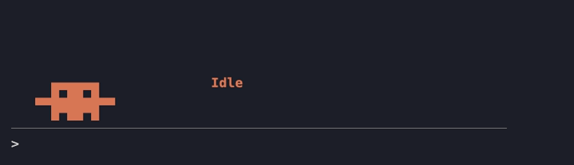

# crab-buddy

**Meet your crab buddy, in your terminal.** Clawd, Claude Code's mascot, sits in the band just above the prompt and acts out what Claude is doing.
The file, command or query in progress shows beside him.



[Play with the demo in your browser →](https://yanonymousv2.github.io/yeshasvi/crab-buddy/#demo)

## What he does

| When Claude is… | Clawd… |
|---|---|
| thinking | looks around, thought bubble `· ∘ ○ ?` |
| writing a reply | bounces and waves |
| reading a file | flips through a page, eyes scanning |
| searching | scuttles sideways with a `⌕` |
| editing | scribbles with a pencil |
| running a command | walks back and forth with `>_`, and slumps and yawns if it runs past 20 seconds |
| browsing the web | watches a spinning globe |
| sending subagents | raises his claws; shows `3 helpers out` when several run at once |
| **waiting for you** (a question or a plan to approve) | waves both claws, `hey!`, until you answer |
| compacting the conversation | squashes flat and springs back |
| hitting an error | `Oops`, eyes shut |
| done | jumps with sparkles |
| idle | blinks, then dozes off (`z Z z`) |

- `/crab` hides him or brings him back (ctrl+x ctrl+a collapses the band too).
- He never blocks or changes a tool call, and a failure in the mod leaves the tool running as usual.

## What the hooks do

crab-buddy only watches. Every hook passes the event on unchanged, and it makes no network calls and stores nothing.

| Hook | What it does |
|---|---|
| `session.start` | registers `/crab` and starts the 300 ms animation timer |
| `command.run` (`/crab` only) | toggles the crab; no other command is touched |
| `turn.start`, `turn.step` | notes that Claude is thinking or writing a reply |
| `tool.call` | notes which tool is running and its file, command or query; the call itself runs as made |
| `session.compact` | shows "Compacting" while the conversation is summarized |
| `turn.complete` | shows "Done" |
| `ui.render` (`AbovePrompt`) | draws the crab in the band above the prompt |

## Settings

Change these in `/plugin` (crab-buddy → configure) or the config menu:

| Setting | Default | |
|---|---|---|
| Crab color | `orange` | `orange`, `blue`, `green`, `purple` or `pink` |
| Doze off after (seconds) | `90` | how long he stays idle before falling asleep |
| Show status text | `true` | turn off to show just the crab |

## Install

At the prompt of a Claude Code terminal session:

```
/plugin install crab-buddy --marketplace yanonymousV2/crab-buddy
```

Answer `y` to add the marketplace, then pick a scope (user installs it for every session).

From a shell:

```
claude plugin install crab-buddy --marketplace yanonymousV2/crab-buddy
```

In the desktop app: click + next to the prompt box, then Plugins, Add marketplace with
`yanonymousV2/crab-buddy`, then Add plugin.

## Development

Clone the repository and run Claude Code with the folder loaded:

```
claude --plugin-dir ./crab-buddy
```

Run the tests with `claude plugin test .` and check the manifest and hooks with `claude plugin validate .`.

## License

MIT

---

Unofficial fan project, not affiliated with or endorsed by Anthropic. Clawd is Claude Code's mascot.
